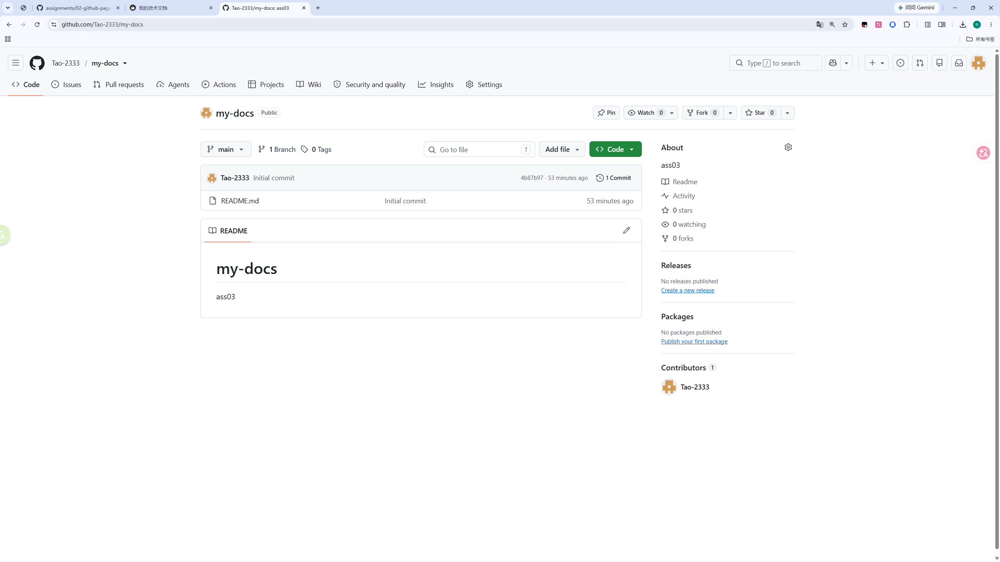
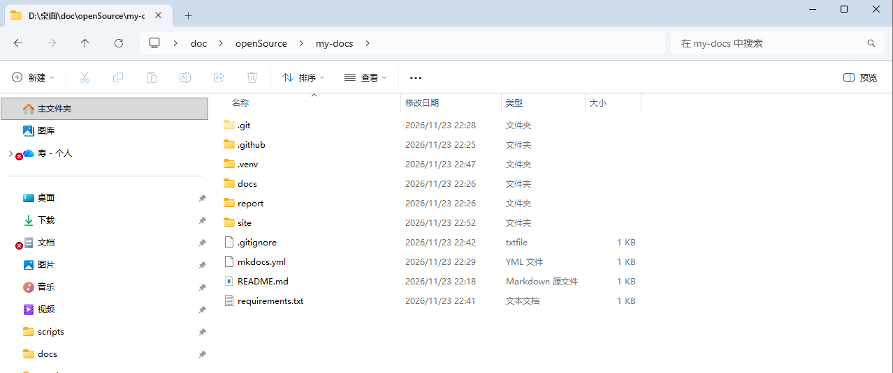
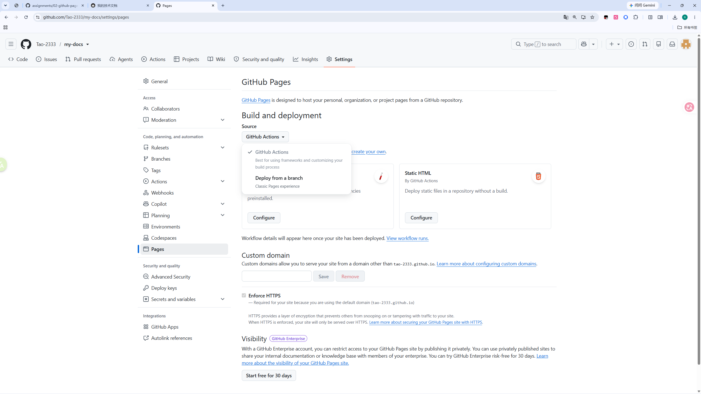
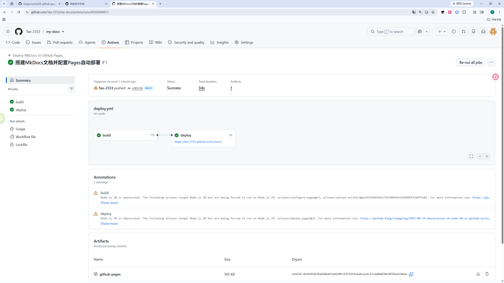
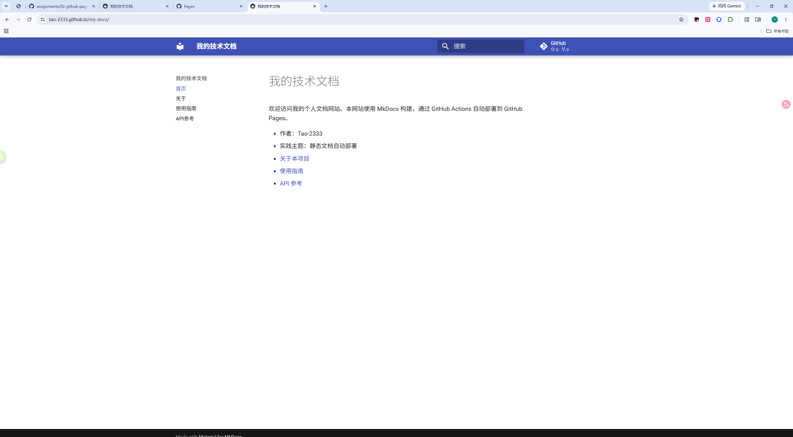
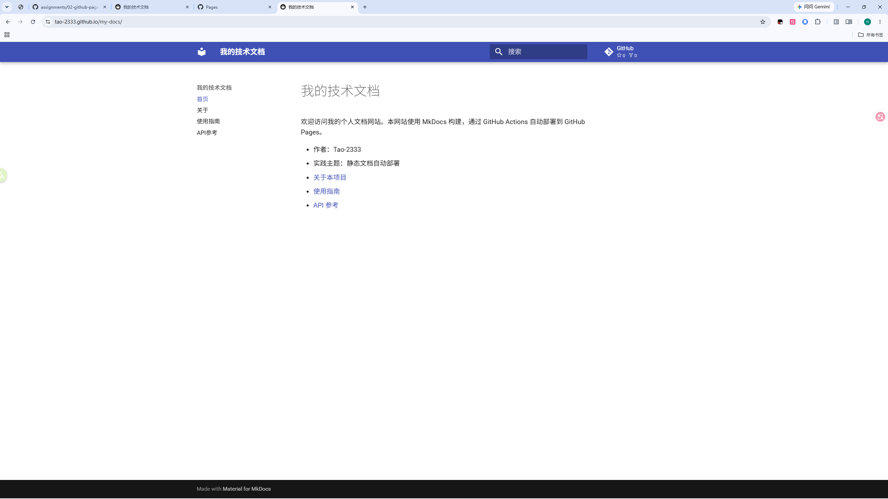
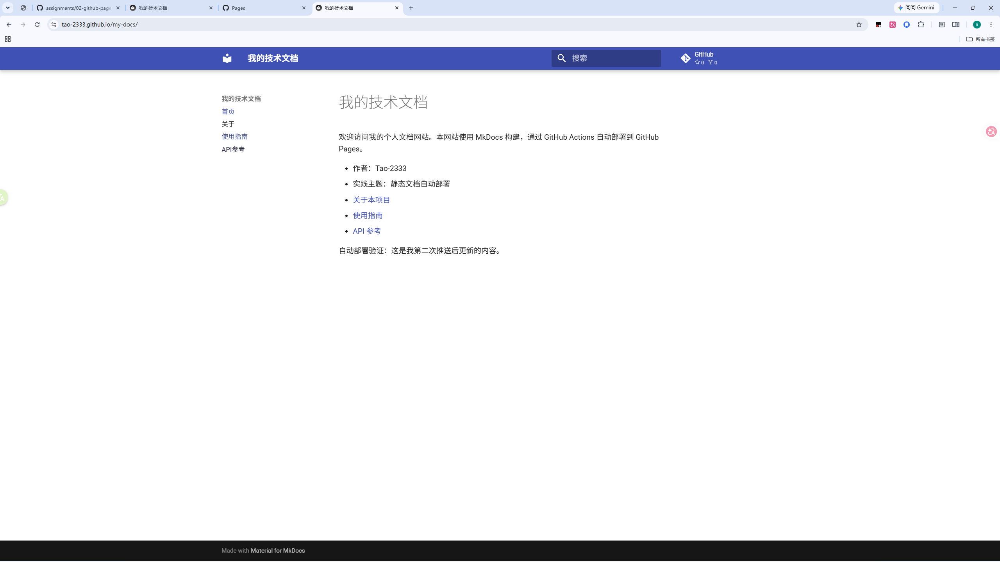

# 实践项目 2：基于 GitHub Actions 的静态文档自动部署

## 1. 基本信息

- **GitHub 登录名**：Tao-2333
- **个人仓库地址**：https://github.com/Tao-2333/my-docs
- **最终网站地址**：https://tao-2333.github.io/my-docs/
- **实践主题**：使用 MkDocs、GitHub Actions 和 GitHub Pages 搭建并自动部署个人技术文档网站

### 1.1 实践目的

本次实践的主要目标是了解静态文档网站的构建和自动部署流程，掌握 Markdown、MkDocs、GitHub Actions 和 GitHub Pages 的基本使用方法。

通过本次实验，实现从本地编写 Markdown 文档，到 GitHub 自动构建并发布网站的完整流程。

同时，通过修改并再次推送文档，验证 GitHub Actions 能否自动检测更新并重新部署网站。

---

## 2. 实践过程与关键截图

### 2.1 创建个人 GitHub 仓库

首先登录个人 GitHub 账号，创建名为 `my-docs` 的公开仓库，并将仓库克隆到本地。

选择公开仓库是为了使其他用户能够访问项目源码及 GitHub Pages 网站。

仓库创建完成后，通过 Git 命令管理本地文件，并将修改提交到远程仓库。



### 2.2 创建项目结构与配置 MkDocs

在本地仓库中创建 `docs` 目录，用于保存 Markdown 文档。

本次网站包含以下四个页面：

- `index.md`：网站首页，介绍网站主题和主要内容。
- `about.md`：关于页面，说明项目背景和使用的技术。
- `guide.md`：使用指南，介绍 Git 的基本使用流程。
- `api.md`：参考文档，整理常用 Git 命令及相关示例。

在项目根目录创建 `mkdocs.yml`，配置网站名称、Material 主题和页面导航。

同时创建 `requirements.txt`，用于记录 MkDocs 及相关依赖。

其中，`docs/` 保存原始 Markdown 文档，而 `site/` 是 MkDocs 在构建过程中自动生成的网站目录。



### 2.3 本地构建与预览

为了避免项目依赖影响其他 Python 环境，首先创建并激活 Python 虚拟环境。

使用以下命令安装依赖：

```bash
python -m pip install -r requirements.txt
```

随后执行：

```bash
python -m mkdocs build --strict
```

该命令将 Markdown 文档构建为静态网站，并在严格模式下检查构建警告。

构建成功后，可以在项目目录中看到自动生成的 `site/` 文件夹。

接着执行：

```bash
python -m mkdocs serve
```

在浏览器中访问：

http://127.0.0.1:8000/

通过本地预览，检查网站导航、Markdown 表格、代码块以及页面之间的链接是否能够正常显示。


### 2.4 配置 GitHub Pages

进入个人 GitHub 仓库，依次打开：

`Settings → Pages`

在 `Build and deployment` 中，将 Source 设置为 `GitHub Actions`。

这一设置表示网站将通过 GitHub Actions 工作流部署，而不是直接从某个 Git 分支发布。

另外，在 `Settings → Actions → General` 中检查 Actions 权限，确认仓库允许执行所需工作流。



### 2.5 配置 GitHub Actions 并首次部署

在项目中创建以下文件：

`.github/workflows/deploy.yml`

该文件定义了 GitHub Actions 自动部署流程，主要包括两个任务。

**Build（构建）**

1. 获取 GitHub 仓库中的源码。
2. 配置 Python 运行环境。
3. 安装 MkDocs 相关依赖。
4. 执行 MkDocs 构建命令。
5. 上传生成的静态网站文件。

**Deploy（部署）**

在构建任务成功后，使用 GitHub Pages 官方部署 Action，将构建产物发布到 GitHub Pages。

完成工作流配置后，将项目提交并推送到远程仓库：

```bash
git add .
git commit -m "搭建MkDocs文档并配置Pages自动部署"
git push origin main
```

进入 GitHub 仓库的 `Actions` 页面，检查工作流运行状态，并确认 `build` 和 `deploy` 两个任务执行成功。



### 2.6 验证网站访问效果

首次部署成功后，通过浏览器打开 GitHub Pages 提供的网站地址：

https://tao-2333.github.io/my-docs/

检查网站是否能够正常访问，并依次查看首页、关于、使用指南和参考文档四个页面。

重点检查页面内容、导航链接、表格和代码块的显示效果。

这一步验证了本地 Markdown 文档已经成功构建并部署为公开的静态网站。



### 2.7 第二次推送与自动更新验证

为了验证自动部署功能，在首次部署成功后，再次修改 `docs/index.md`，增加一段用于验证自动更新的文字。

随后执行：

```bash
git add docs/index.md
git commit -m "验证文档修改后自动更新网站"
git push origin main
```

这一次不手动执行部署，而是通过推送操作触发工作流。

在 GitHub Actions 页面查看新的工作流运行记录，检查是否由 `push` 事件自动触发，以及构建和部署是否成功。



随后刷新 GitHub Pages 网站，检查新增内容是否出现在网页中。

通过对比修改前后的页面内容，可以验证自动部署流程是否正常工作。



- **第二次提交地址**：待填写实际 Commit 链接
- **第二次 Actions 运行地址**：待填写实际运行链接

---

## 3. 问题与解决

### 3.1 Python 环境版本的选择

**问题：**

本地原有 Python 环境为 3.11.9，而实验指导建议使用 Python 3.12，因此需要考虑如何选择合适的运行环境。

**解决方法：**

了解 Python 多版本共存以及虚拟环境的使用方式，通过指定 Python 版本创建虚拟环境，避免不同项目之间的依赖冲突。

例如：

```bash
py -3.12 -m venv .venv
```

在 Windows PowerShell 中通过以下命令激活：

```powershell
.\.venv\Scripts\Activate.ps1
```

**理解：**

Python 虚拟环境可以为不同项目提供相对独立的包管理环境，降低依赖版本冲突的可能性。

### 3.2 本地构建与远程部署的区别

**问题：**

实验过程中，需要理解本地执行 `mkdocs build` 与 GitHub Actions 自动部署之间的关系，以及何时需要将本地代码推送到远程仓库。

**解决方法：**

先在本地通过 MkDocs 构建并预览网站，确认文档内容和配置没有明显问题。

然后配置 GitHub Pages 和 GitHub Actions 工作流，再将项目推送到 GitHub。

**理解：**

本地构建主要用于验证文档是否能够生成网站；远程部署则通过 GitHub Actions 在云端重新构建并发布网站。

两者使用相同的项目源码，但执行环境和最终目的不同。

### 3.3 GitHub Actions 权限配置

**问题：**

GitHub 仓库提供了多种 Actions 权限和 Pages 发布设置，需要确定本次实验应该使用哪种方式。

**解决方法：**

在 Actions 设置中允许执行工作流，在 Pages 设置中选择 `GitHub Actions` 作为发布来源。

部署权限则由工作流中的 `pages: write` 和 `id-token: write` 提供。

**理解：**

GitHub Actions 负责执行自动化任务，GitHub Pages 负责托管最终生成的网站。二者需要通过相应的设置和权限进行配合。

---

## 4. 原理理解

### 4.1 `docs/` 和 `site/` 分别保存什么？为什么不用手工修改 `site/`？

`docs/` 目录用于保存网站的 Markdown 源文件，是平时编写和修改文档的主要位置。

`site/` 目录用于保存 MkDocs 构建后生成的静态网站文件，包括 HTML、CSS、JavaScript 等内容。

由于 `site/` 中的文件是根据源文档和配置自动生成的，下一次构建时可能被覆盖，因此不应该直接修改其中的内容。

正确做法是修改 `docs/` 中的源文件，再通过 MkDocs 重新构建网站。

### 4.2 本次工作流在什么情况下自动运行？

本次工作流主要通过 `push` 事件触发。

当修改被推送到 `main` 分支，且涉及 `docs/`、`mkdocs.yml`、`requirements.txt` 或工作流文件等指定路径时，就会自动运行。

另外，工作流配置了 `workflow_dispatch`，因此也可以在 GitHub Actions 页面手动触发。

### 4.3 `build` 与 `deploy` 两个任务有什么区别？

`build` 负责将文档源码转换为可发布的静态网站。

它包括获取源码、配置环境、安装依赖、执行构建以及上传构建产物。

`deploy` 则负责将前一个任务产生的构建产物发布到 GitHub Pages，使网站能够通过公开 URL 访问。

两者具有先后依赖关系，工作流中的 `needs: build` 确保 `build` 成功后才运行 `deploy`。

简单来说：

**build 负责生成网站，deploy 负责发布网站。**

### 4.4 只修改 `report/README.md` 会触发部署吗？为什么？

不会。

因为本次工作流在 `push` 触发条件中设置了 `paths`，只监听指定文件和目录的修改。

`report/README.md` 不在这些路径中，因此如果一次推送只包含报告文件的修改，就不会自动触发部署。

这样可以避免与网站内容无关的修改造成不必要的构建和部署。

### 4.5 为什么本次方案不需要创建 `gh-pages` 分支？

传统的 GitHub Pages 发布方式可以通过指定分支保存和发布网站文件。

但本次实验使用的是 GitHub 官方 Pages Actions 工作流。

在该方案中，MkDocs 构建生成的 `site/` 目录会作为构建产物上传，然后通过 `actions/deploy-pages` 直接部署到 GitHub Pages。

因此不需要额外创建或维护 `gh-pages` 分支。

这种方式将网站源码和部署产物分离，也使自动部署过程更加清晰。

---

## 5. 实践总结

通过本次实验，我学习了使用 MkDocs 将 Markdown 文档构建为静态网站的方法，也进一步熟悉了 Git 和 GitHub 的基本使用流程。

相比单纯在本地编写文档，本次实验增加了自动构建和远程部署的环节，使我对软件项目从源码到最终发布的过程有了更加完整的认识。

其中，我认为比较重要的一点是理解 GitHub Actions 的作用：它能够在满足触发条件时自动执行预先定义好的任务，从而减少重复的手工操作。

通过两次提交和部署验证，可以进一步理解持续集成与持续部署的基本思想，即在代码或文档发生变化后，利用自动化流程完成构建、检查与发布。

本次实践也让我认识到，技术文档不仅是知识记录的工具，也可以通过版本控制和自动化部署进行维护和更新。

---

## 6. 项目相关链接

- **GitHub 源码仓库**：https://github.com/Tao-2333/my-docs
- **GitHub Pages 网站**：https://tao-2333.github.io/my-docs/
- **实验报告**：https://github.com/Tao-2333/my-docs/blob/main/report/README.md
- **第二次部署验证**：待填写实际 Actions 运行地址